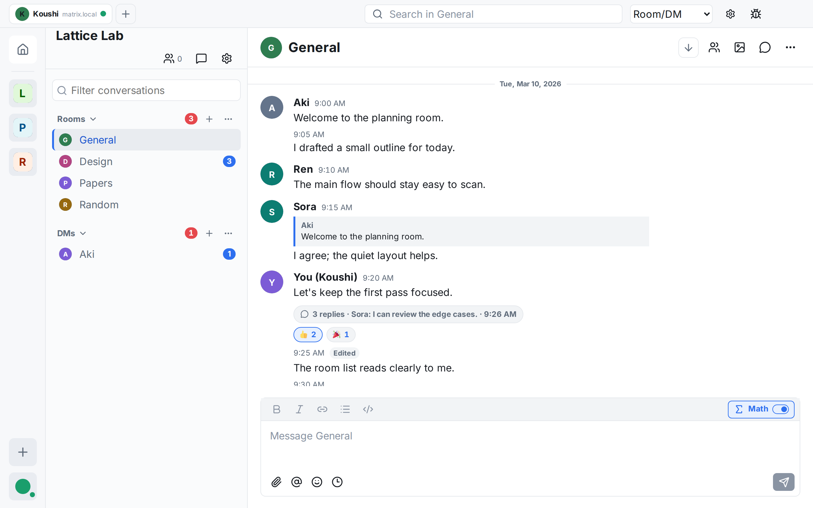

# Koushi (光子・格子)

<p align="center">
  <a href="https://shinaoka.github.io/koushi-matrix/"></a>
</p>

<p align="center">
  <strong>A desktop Matrix client for many languages, and for your AI assistant.</strong>
</p>

<p align="center">
  <a href="https://shinaoka.github.io/koushi-matrix/"><strong>🌐 Website</strong></a>
  &nbsp;·&nbsp;
  <a href="https://github.com/shinaoka/koushi-matrix/releases/latest/download/Koushi-macos-arm64.dmg"><strong>⬇️ Download for macOS</strong></a>
  &nbsp;·&nbsp;
  <a href="https://matrix.to/#/#koushi-matrix:matrix.org"><strong>💬 Community room</strong></a>
</p>

<p align="center">
  Website in
  <a href="https://shinaoka.github.io/koushi-matrix/">English</a> ·
  <a href="https://shinaoka.github.io/koushi-matrix/ja/">日本語</a> ·
  <a href="https://shinaoka.github.io/koushi-matrix/zh-Hans/">简体中文</a> ·
  <a href="https://shinaoka.github.io/koushi-matrix/zh-Hant/">繁體中文</a> ·
  <a href="https://shinaoka.github.io/koushi-matrix/ko/">한국어</a>
</p>



## Why Koushi?

- **All your accounts, one window.** Each Matrix account gets its own tab and
  stays signed in and syncing, with its own unread count.
- **Multilingual by design.** IME-safe typing, and search that handles Japanese,
  Chinese, and Korean text. The interface is available in English, Japanese,
  Simplified Chinese, Traditional Chinese, and Korean.
- **Find the conversation again.** Local full-text search, including encrypted
  rooms.
- **Notifications even when your server sends none.** Koushi can email you
  (Resend or SMTP) or notify WeChat (ServerChan) from your own computer.
- **Works with your AI assistant.** Koushi can act as a local MCP server, so
  Claude Code, Codex, and other MCP clients can search, summarize, and reply to
  your chats through the running app, only for the accounts you allow.
- **Desktop first.** Three-pane layout, threads, Markdown, code, math, keyboard
  shortcuts, system tray, and native notifications.

The [website](https://shinaoka.github.io/koushi-matrix/) has screenshots and the
full list. Koushi uses the [Matrix](https://matrix.org) protocol through the
Matrix Rust SDK, with a Rust core and a Tauri desktop shell. Voice and video
calls, screen sharing, bots, and widgets are not included yet.

## Use Koushi from your AI assistant

Koushi can act as a local [Model Context Protocol](https://modelcontextprotocol.io)
server. Your assistant talks to the Koushi app already open on your computer,
so it never holds your encryption keys. Then just ask:

> Which rooms have unread messages? Summarize the Design room.
>
> Find the invoice someone sent me last month.
>
> Reply to that message saying I will send the file tomorrow.

- **Read:** list rooms with unread counts and mentions, read recent messages,
  and search history, including encrypted rooms.
- **Act:** send messages and replies, download attachments, and wait for new
  activity.
- **You decide:** until you grant access, an assistant sees only account ids.
  Reading, sending, and attachments are separate permissions, per assistant and
  per account.

```bash
claude mcp add --scope user koushi -- /path/to/koushi-mcp --client-name claude-code
```

The `koushi-mcp` launcher ships with Koushi, and **App Settings → AI
assistants** shows its path ready to copy. The first time an assistant asks for
something, Koushi shows an approval dialog; you can change or remove access
later on the same settings page. See [Connect an AI assistant](docs/help/ai-assistants.md) for Claude
Code, Codex, other MCP clients, and URL-only connectors.

## Downloads

- [macOS Apple Silicon DMG](https://github.com/shinaoka/koushi-matrix/releases/latest/download/Koushi-macos-arm64.dmg)
- Untested: [Windows x64 installer](https://github.com/shinaoka/koushi-matrix/releases/latest/download/Koushi-windows-x64-unsigned.exe) (unsigned; SmartScreen may warn),
  [Linux AppImage](https://github.com/shinaoka/koushi-matrix/releases/latest/download/Koushi-linux-x64.AppImage),
  [deb](https://github.com/shinaoka/koushi-matrix/releases/latest/download/Koushi-linux-x64.deb),
  [RPM](https://github.com/shinaoka/koushi-matrix/releases/latest/download/Koushi-linux-x64.rpm)
- [All releases and checksums](https://github.com/shinaoka/koushi-matrix/releases/latest): verify the adjacent `.sha256` file.

## Platform Support

- **macOS (Apple Silicon): officially supported.** Releases are Developer ID
  signed, notarized, stapled, and checked by Gatekeeper.
- **Windows and Linux: built by CI but untested.** The maintainer has no
  Windows hardware; only an Ubuntu 24.04 WSL2 build has been launched.
  Testers and maintainers for these platforms are very welcome.

## Help

Read the [user guide](docs/help/README.md), or ask ChatGPT or another AI
assistant in your own language. Include the repository URL, your Koushi
version, and your operating system, for example:

> I use Koushi version [version] on [operating system]. Please consult
> https://github.com/shinaoka/koushi-matrix, read the user guide for my release
> tag, and explain how to search past messages. Link to the sources you used.

[llms.txt](llms.txt) indexes the same help for AI readers. See
[version selection](docs/help/README.md#choose-the-right-version) for an
installed release.

## Contributing

Issues and pull requests are welcome, especially from Windows and Linux users.
To build from source, see [Develop Koushi](docs/development.md).

## The name

**Koushi** (コウシ) is a Japanese double pun: **光子** (*photon*: light, signal)
and **格子** (*lattice*: a grid, a nod to Matrix). The logo is a photon resting on
a lattice.

## License

MIT OR Apache-2.0, at your option ([LICENSE-MIT](LICENSE-MIT),
[LICENSE-APACHE](LICENSE-APACHE)). Unless you explicitly state otherwise, any
contribution intentionally submitted for inclusion, as defined in the
Apache-2.0 license, is dual licensed as above without additional terms.
Third-party attributions are in [THIRD_PARTY_NOTICES.md](THIRD_PARTY_NOTICES.md).

Terminal users can use the bundled read-only `koushi` CLI; see [Command-line access](docs/help/command-line.md).
