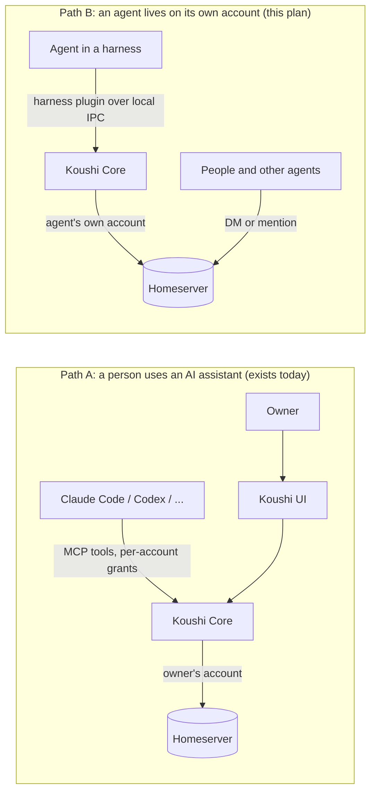
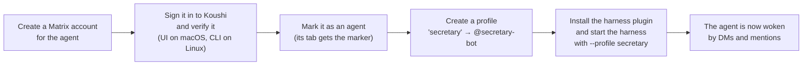
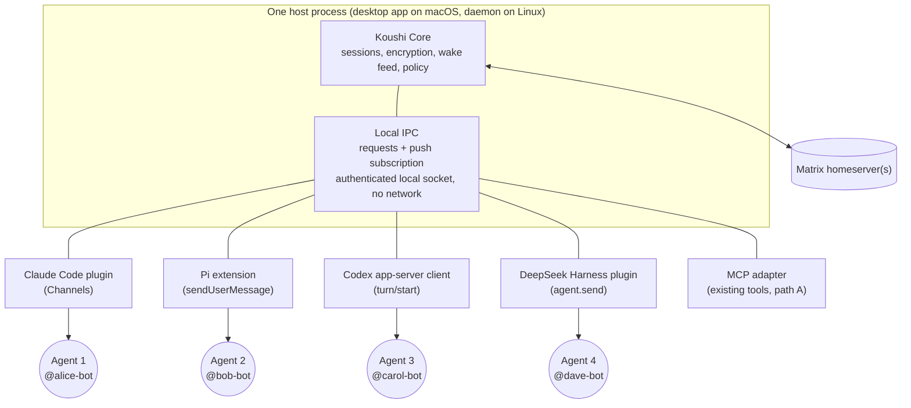
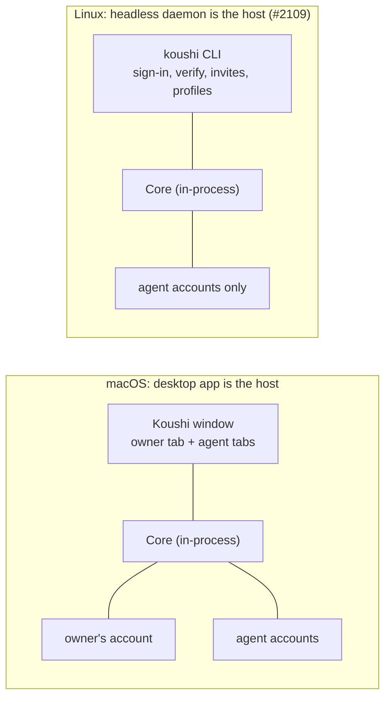
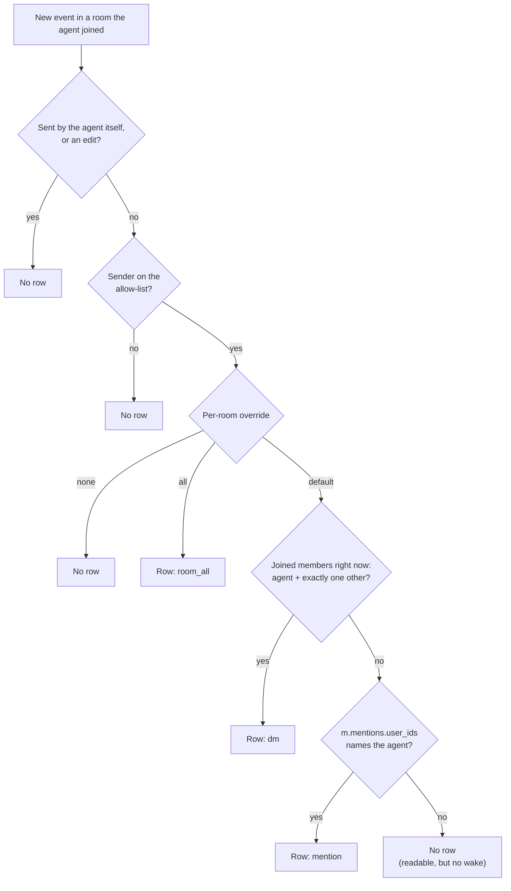
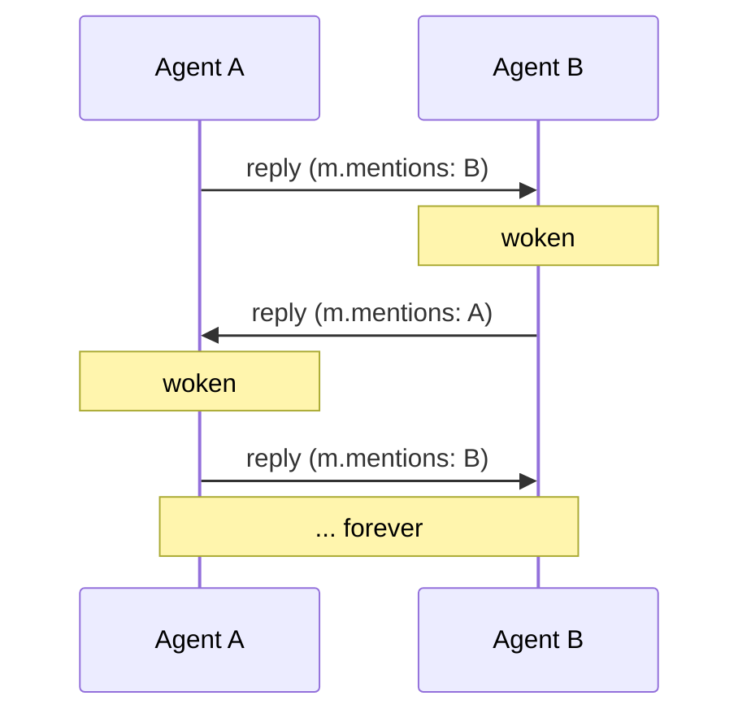
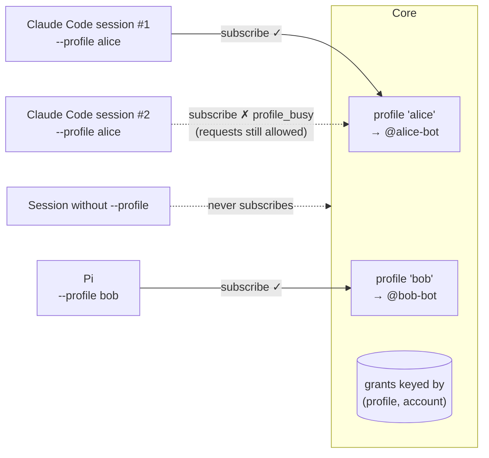
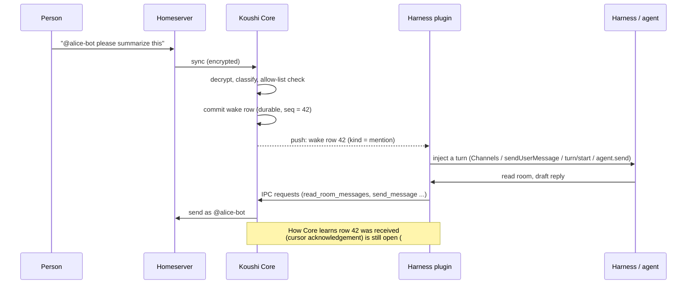
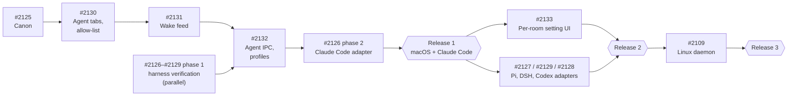

# #2124 - Agents on their own Matrix accounts: illustrated overview

Status: overview of an approved plan, not canon. Umbrella issue: #2140. The canon change is #2125;
until it lands, the code and `docs/architecture/overview.md` describe today's
behavior. This page puts the decisions spread across #2124, its child issues
(#2125–#2133), #2109 and #2110 in one place, starting with how
the feature is meant to be used,, with pictures. When this page and
an issue disagree, the epic #2124 wins; fix this page.

## Two ways an AI meets Koushi

Koushi serves two different people-and-AI arrangements. This plan is only
about path B.



In path B the agent is a Matrix user of its own. People talk to it in DMs or
mention it in rooms. Koushi keeps its verified session and encryption keys, and
decides when it should be woken.

## Typical uses

Each situation names the release that makes it possible. Account names are
examples.

### Setting up an agent (once per agent)



### 1. A personal secretary on your Mac (Release 1)

You keep Koushi open on your Mac with your own account and `@secretary-bot`.
A Claude Code session runs with the Koushi channel plugin and
`--profile secretary`.

1. From your phone (any Matrix client) you DM `@secretary-bot`: "Summarize
   what happened in #project today."
2. The DM wakes the agent; you do not mention it, because every DM message
   wakes it.
3. The agent reads #project (a room its account has joined), writes the
   summary and replies in the DM.
4. On the Mac you can open the agent's tab at any time and see exactly what it
   read and sent.

### 2. An assistant in a team room (Release 1)

`@helper-bot` is a member of #project alongside several people. It reads the
whole room but stays quiet.

- "Did anyone decide on the release date?" → no mention, the agent is not
  woken.
- "@helper-bot what did we decide on the release date?" → a mention wakes it.
  It reads the earlier messages for context and answers in the room or in the
  thread.
- A keyword that happens to highlight for a person (for example "helper") does
  not wake it; only a real mention does.

### 3. A room the agent watches completely (Release 1 in Core, Release 2 in the UI)

#ci-alerts receives build failures. The owner sets that room to `all`, so every
message from an allowed sender wakes `@triage-bot`, which looks at the failure
and posts a first diagnosis. Setting a noisy room to `none` makes the agent
read it only when asked about it elsewhere.

### 4. Several agents on one machine (Release 1 if all use Claude Code; Release 2 for other harnesses)

`@coder-bot` runs in Claude Code with `--profile coder`, `@reviewer-bot` in Pi
with `--profile reviewer`. Both are in #project.

- "@coder-bot implement X" wakes only the coder. "@reviewer-bot please review"
  wakes only the reviewer.
- When the coder replies to the reviewer, the reply mentions the reviewer, but
  agents are not on each other's default allow-list, so no loop starts.
- If you do want the coder to hand work to the reviewer, add `@coder-bot` to
  the reviewer's allow-list explicitly.
- Starting a second Claude Code session with `--profile coder` does not steal
  the coder's events: it gets `profile_busy` for the subscription.

### 5. The agent is invited to a new room (Release 1)

A colleague (an allowed sender) invites `@secretary-bot` to #budget. The agent
gets an `invite` row and can tell you "I was invited to #budget by Alice". It
cannot join by itself. You accept in its tab (macOS) or with
`koushi invite accept` (Linux), and from then on it reads #budget and is woken
by mentions there.

### 6. An agent on a Linux server (Release 3)

A headless server runs the `koushi` daemon with agent accounts only; your own
account and keys stay on your own machines.

1. Sign the agent in with the CLI (password from stdin, or an OIDC URL to open
   elsewhere) and verify it with the recovery key from stdin.
2. Create a profile with the CLI and start Codex, Pi or DeepSeek Harness with
   it.
3. Accept invites with `koushi invite list` / `koushi invite accept`.
4. People talk to the agent exactly as in situations 1–5.

## The big picture



- **Core decides everything**: what wakes an agent, who may wake it, which
  account a plugin may use. Plugins only forward.
- **MCP alone cannot wake an agent.** Most MCP clients do not start a turn when
  a server sends a notification. Each harness has its own injection point, so
  each gets its own thin plugin on the same IPC.
- **Several agents on one machine**, each on its own Matrix account, at the
  same time.

## Where Core runs



| | macOS | Linux |
| --- | --- | --- |
| Host | the desktop app, left running | `koushi` daemon, no UI |
| Accounts | owner and agents side by side | agents only; the owner's keys never sit on the agent machine |
| Sign-in | UI | CLI; password from stdin or an OIDC URL |
| Verification | UI | CLI; recovery key from stdin, never argv |
| Accept invites | in the agent's tab | `koushi invite list` / `koushi invite accept` |
| Create profiles | UI | CLI |
| Key storage | macOS Keychain | **open**: 0600 key file or systemd credentials; fails closed until decided |

## Agent tabs stay visible (macOS)

```text
┌────────────────────────────────────────────┐
│ [ Me (3) ] [ 🤖 alice-bot (5) ] [ 🤖 bob-bot ✉1 ] │  ← agent tabs: marker + own counts
├────────────────────────────────────────────┤
│  The owner can open an agent's tab, see    │
│  what it reads and sends, and accept its   │
│  invites.                                  │
└────────────────────────────────────────────┘
Dock badge / OS notifications: owner only.
```

Agent tabs cannot be hidden, show their own unread and invite counts, carry an
agent marker, and stay out of OS notifications and the global badge (#2130).

## Reading versus waking

An agent may **read** every room its account has joined. It is **woken** only
by some messages.



- **DM** = the agent plus exactly one other joined member, judged when the
  event arrives. `m.direct` is not used: clients set it inconsistently. A later
  membership change does not rewrite old rows.
- **Mention** = only `m.mentions.user_ids`. Push-rule highlights (keywords,
  display names) are a person's notification settings and do not count.
- **Per-room override** `all` / `mentions` / `none`, stored in Core. Defaults:
  `all` for a DM, `mentions` elsewhere. The UI comes in #2133.
- **Invites** produce an `invite` row from an allowed sender, as information
  only, so the agent can tell its owner. No tool lets an agent accept or
  decline; a person does (#2131, and #2109 on Linux).

### What changes from today's code (#2131)

| Rule | Today (#2118) | Target |
| --- | --- | --- |
| DM | SDK `room.is_direct()` (reads `m.direct`) | member count at arrival |
| Mention | push-rule highlight **or** `m.mentions` | `m.mentions` only |
| Group room, every message | not possible | `room_all` via override |
| Invite | `invite` row for allowed senders | unchanged; information only |

## Why agents are out of the default allow-list

A Matrix reply puts the replied-to sender in `m.mentions`. Two agents that may
wake each other therefore loop:



So the derived default allow-list is "every signed-in account that is **not**
an agent". The owner may still add an agent explicitly (#2130).

## Profiles: one plugin connection, one account



- Only the owner creates profiles (UI on macOS, CLI on Linux).
- A profile is bound to exactly one account; grants are per (profile, account),
  so one agent's permissions never leak to another account.
- **One subscriber per profile.** The lease is released when the connection
  drops. A second connection gets `profile_busy` for the subscription.
- A plugin subscribes only when a profile is named explicitly at launch, so an
  ordinary session that loaded the plugin cannot swallow events.

## One message, end to end



Rows are durable in the encrypted store (1000 rows / 30 days per account), so a
plugin that reconnects resumes from its cursor instead of losing messages.

## Harness injection points (verified in #2126–#2129)

| Harness | How the plugin starts an agent turn | Issue |
| --- | --- | --- |
| Claude Code | MCP server opted in with `--channels` sends `notifications/claude/channel` | #2126 |
| Pi | extension calls `sendUserMessage()` | #2127 |
| Codex | app-server client calls `turn/start` | #2128 |
| DeepSeek Harness | plugin calls `agent.send()` on a created or resumed agent | #2129 |

Each issue has phase 1 (verify the mechanism, findings only) and phase 2 (ship
the adapter). Claude Code Channels have known limits that the verification must
cover: opt-in per session, a development flag for non-official plugins that
works only in interactive sessions, and no delivery acknowledgement.

## Stages and releases



Every stage starts with a failing headless test on disposable local
homeservers, leaves Koushi working, and lands as its own PR. Profiles, grants
and the IPC are authorization and cross-layer changes, so their design and
diff get independent review.

## Still open

- **Cursor acknowledgement** for the push subscription. Decided in #2132 after
  the four harness verifications report, because some harnesses cannot tell a
  plugin that the agent received an event.
- **Store-key storage on a headless Linux host** (0600 key file or systemd
  credentials). The repository rules require the OS secret store today; a host
  without one fails closed until this is decided (#2125, #2109).

## Out of scope

- A network-reachable IPC.
- An agent reading the owner's rooms (that is path A).
- Voice and video.
